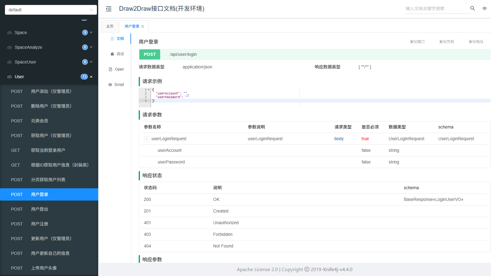
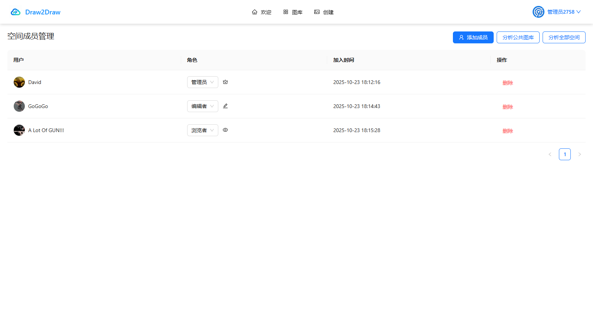
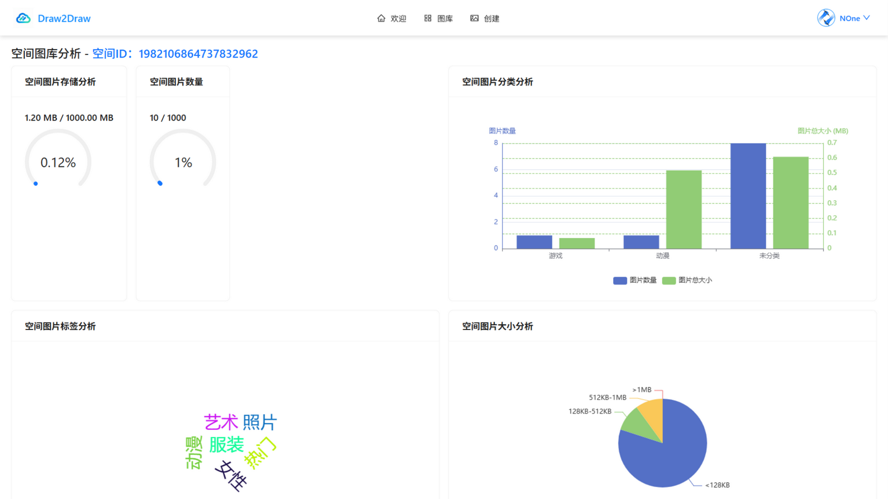
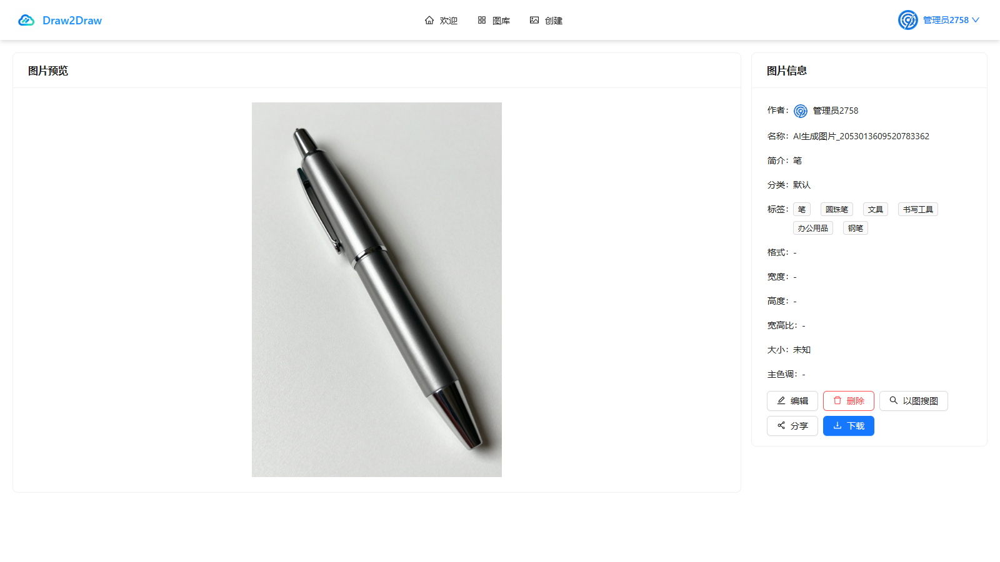
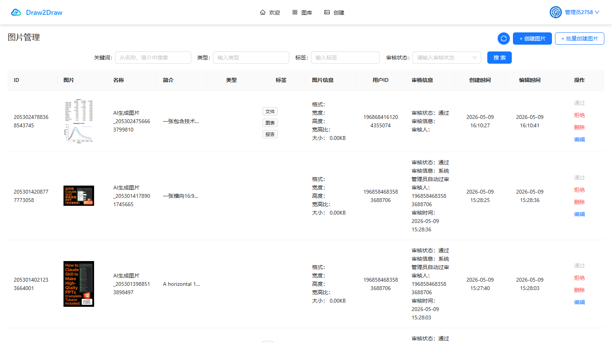
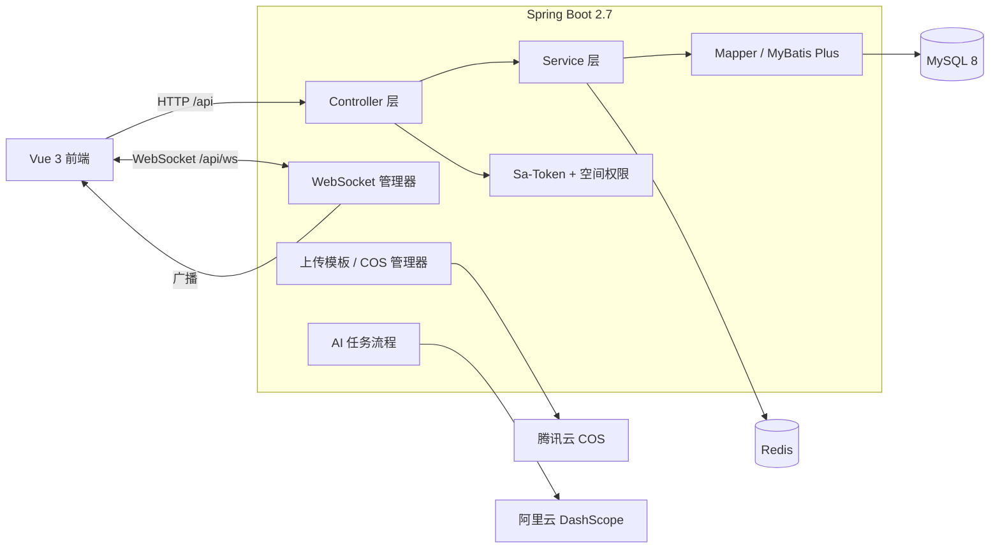
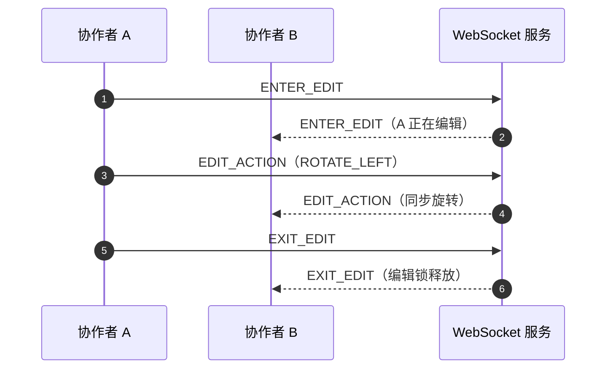

<div align="center">

# Draw2Draw 后端

**基于 Spring Boot 的智能协同云图库后端服务**

用户与权限、图片管理、个人 / 团队空间、WebSocket 实时协同、AI 生图与空间数据分析。

[](https://spring.io/projects/spring-boot)
[](https://www.oracle.com/java/)
[](https://www.mysql.com/)
[](https://redis.io/)
[](https://doc.xiaominfo.com/)

[后端仓库](https://github.com/X1aoM1ngTX/draw2draw-backend) · [系统预览](#-系统预览) · [架构](#-系统架构) · [快速开始](#-快速开始) · [API 说明](#-api-说明)

</div>

## 📖 简介

本仓库是 Draw2Draw 的后端服务，使用 Spring Boot 2.7 + MyBatis Plus + MySQL + Redis 构建，提供统一 REST API 与 WebSocket 协同编辑能力，并与腾讯云 COS、阿里云 DashScope 集成。

服务默认运行在 `8090` 端口，统一上下文路径为 `/api`；接口文档使用 Knife4j 生成，启动后可在 `/api/doc.html` 在线调试。

## 📸 系统预览

后端通过 REST API 支撑前端的全部业务界面，同时提供 Knife4j 在线接口文档与调试能力。



| 空间成员与角色管理（权限模型） | 空间数据分析（统计接口） |
| --- | --- |
|  |  |

| 图片详情（文件与元数据接口） | 图片审核（管理员接口） |
| --- | --- |
|  |  |

> 截图为 Draw2Draw 前端调用后端接口的真实界面；完整前端界面见[前端仓库](https://github.com/X1aoM1ngTX/draw2draw-frontend)。

## 🏗️ 系统架构



分层约定：

- `controller`：参数校验、调用 Service、返回 `BaseResponse`
- `service` / `service.impl`：业务逻辑
- `mapper`：MyBatis Plus 数据访问
- `manager`：与第三方服务或通用能力交互（COS、上传、AI、协同、分表、权限）
- `model`：`entity` / `dto` / `vo` / `enums`

## 🧰 技术栈

| 分类 | 技术 |
| --- | --- |
| 核心框架 | Spring Boot 2.7.6（Web、AOP、WebSocket）、Java 8 |
| 数据存储 | MySQL 8.0、MyBatis Plus 3.5.14（分页插件） |
| 缓存 / 会话 | Redis、Spring Session + Redis、Caffeine 3.1.8 |
| 认证授权 | Sa-Token 1.39.0（`sa-token-redis-jackson`）、`@AuthCheck` 注解 + AOP |
| 实时协同 | Spring WebSocket + Disruptor 3.4.2（无锁事件队列） |
| 对象存储 | 腾讯云 COS（cos_api 5.6.247） |
| AI 能力 | 阿里云 DashScope `z-image-turbo`（文生图 / 图生图） |
| 接口文档 | Knife4j 4.4.0（OpenAPI 2） |
| 分库分表 | ShardingSphere 5.2.0（按空间分表，默认关闭） |
| 工具 | Hutool 5.8.40、Lombok、Jsoup |
| 测试 | JUnit 5、Spring Boot Test |

## 📁 目录结构

```text
draw2draw-backend/
├── src/main/java/com/xm/draw2drawbackend/
│   ├── controller/
│   │   ├── UserController.java           # 注册 / 登录 / 用户管理 / VIP
│   │   ├── PictureController.java        # 上传 / 编辑 / 搜索 / 审核 / 批量
│   │   ├── SpaceController.java          # 私有 / 团队空间
│   │   ├── SpaceUserController.java      # 空间成员与角色
│   │   ├── SpaceAnalyzeController.java   # 空间统计分析
│   │   ├── AiImageController.java        # AI 生图任务
│   │   ├── FileController.java           # 文件上传
│   │   └── MainController.java           # 健康检查
│   ├── service/                          # 业务接口与 impl 实现
│   ├── mapper/                           # MyBatis Plus Mapper
│   ├── model/
│   │   ├── entity/                       # User / Picture / Space / SpaceUser / AiGenerateTask
│   │   ├── dto/ vo/                      # 请求与响应对象
│   │   └── enums/                        # 用户角色 / 空间角色 / 审核状态 / 任务状态
│   ├── manager/
│   │   ├── CosManager.java               # 腾讯云 COS
│   │   ├── FileManager.java              # 上传校验
│   │   ├── AiImageManager.java           # AI 任务、额度
│   │   ├── SpacePictureManager.java      # 空间图片与配额
│   │   ├── auth/                         # 空间权限
│   │   ├── upload/                       # 上传模板
│   │   ├── websocket/                    # 协同编辑、Disruptor 事件处理
│   │   └── sharding/                     # 分表算法
│   ├── api/zimageturbo/                  # DashScope API 封装
│   ├── config/                           # COS / CORS / 线程池 / Knife4j 等
│   ├── annotation/ aop/                  # @AuthCheck 权限注解与切面
│   ├── common/ exception/                # BaseResponse / ResultUtils / ErrorCode / 全局异常
│   ├── constant/ utils/                  # 常量、加密、图片、Web 工具
│   └── Draw2drawBackendApplication.java
├── src/main/resources/
│   ├── application.yml                   # 公共配置（默认激活 dev）
│   ├── application-dev.yml               # 开发环境配置
│   ├── application-prod.yml              # 生产环境配置
│   ├── application-prod-template.yml     # 生产配置模板（占位符）
│   ├── generator/mapper/                 # Mapper XML
│   └── sql/create_ai_generate_table.sql  # AI 任务表建表脚本
├── src/test/                             # 单元测试
├── Dockerfile
└── pom.xml
```

## 🚀 快速开始

### 环境要求

| 依赖 | 版本 |
| --- | --- |
| Java | 1.8+ |
| Maven | 3.6+ |
| MySQL | 8.0+ |
| Redis | 6.0+ |
| 腾讯云 COS | 图片存储（可选，上传功能需要） |
| 阿里云 DashScope | API Key（AI 生图需要） |

### 1. 初始化数据库

```sql
CREATE DATABASE d2d CHARACTER SET utf8mb4 COLLATE utf8mb4_unicode_ci;
```

```bash
# 导入基础表（user / picture / space / space_user）
mysql -uroot -p d2d < ../d2d.sql

# 导入 AI 生图任务表
mysql -uroot -p d2d < src/main/resources/sql/create_ai_generate_table.sql
```

### 2. 修改配置

默认激活 `dev` 配置，编辑 `src/main/resources/application-dev.yml`：

```yaml
spring:
  datasource:
    url: jdbc:mysql://localhost:3306/d2d
    username: your_username
    password: your_password
  redis:
    host: localhost
    port: 6379
    database: 1

server:
  port: 8090
  servlet:
    context-path: /api

cos:
  client:
    host: https://your-bucket.cos.ap-guangzhou.myqcloud.com
    secretId: your-secret-id
    secretKey: your-secret-key
    region: ap-guangzhou
    bucket: your-bucket

dashscope:
  api-key: your-dashscope-api-key
  image-model: z-image-turbo
```

> 🔐 请使用自己的密钥，不要把真实的 `secretId` / `secretKey` / `api-key` 提交到仓库。

### 3. 启动应用

```bash
# 编译并打包
mvn clean install

# 开发模式启动（默认 dev）
mvn spring-boot:run
```

### 4. 验证

| 检查项 | 地址 |
| --- | --- |
| 健康检查 | <http://localhost:8090/api/health> |
| Knife4j 接口文档 | <http://localhost:8090/api/doc.html> |
| 用户登录接口 | `POST http://localhost:8090/api/user/login` |

健康检查返回：

```json
{ "code": 0, "data": "ok", "message": "ok", "description": "成功" }
```

## 🔌 API 说明

### 统一响应

所有接口统一前缀 `/api`，返回结构：

```json
{
  "code": 0,
  "data": {},
  "message": "ok",
  "description": "成功"
}
```

| 字段 | 说明 |
| --- | --- |
| `code` | `0` 表示成功，非 `0` 为业务错误码 |
| `data` | 业务数据，可能为对象、数组或基本类型 |
| `message` | 简要结果 |
| `description` | 详细描述 |

### 错误码

| 错误码 | 含义 |
| --- | --- |
| `40000` | 请求参数错误 |
| `40001` | 请求参数为空 |
| `40100` | 未登录 |
| `40101` | 用户无权限 |
| `50000` | 系统内部异常 |
| `50001` | 资源未找到 |
| `50100+` | 用户业务错误（不存在、密码错误、账号禁用等） |
| `50500+` | 文件上传 / 存储相关错误 |

完整枚举见 `exception/ErrorCode.java`。

### 主要模块

| 模块 | 基础路径 | 说明 |
| --- | --- | --- |
| 用户 | `/user` | 注册、登录、登出、用户管理、VIP 兑换 |
| 图片 | `/picture` | 上传、编辑、搜索、审核、批量操作、分享 |
| 空间 | `/space` | 私有 / 团队空间、容量配额 |
| 空间成员 | `/space/user` | 邀请、角色调整、移除成员 |
| 空间分析 | `/space/analyze` | 容量、分类、标签、大小分布统计 |
| AI 生图 | `/ai/image` | 创建任务、查询进度、任务列表 |
| 文件 | `/file` | 通用文件上传 |
| 健康检查 | `/health` | 服务状态 |

## 🔄 WebSocket 实时协同

### 连接

| 项目 | 说明 |
| --- | --- |
| 端点 | `ws://localhost:8090/api/ws/picture/edit?pictureId={pictureId}` |
| 认证 | 握手阶段从 Session 中读取登录用户 |
| 权限 | 图片存在、属于团队空间、用户拥有 `picture:edit` 权限 |
| 消息格式 | JSON |

### 消息类型

| 类型 | 方向 | 说明 |
| --- | --- | --- |
| `INFO` | 服务端 → 客户端 | 系统通知 |
| `ERROR` | 服务端 → 客户端 | 错误提示 |
| `ENTER_EDIT` | 双向 | 进入编辑状态，服务端记录编辑锁并广播 |
| `EXIT_EDIT` | 双向 | 退出编辑状态，释放编辑锁并广播 |
| `EDIT_ACTION` | 双向 | 编辑操作：`ZOOM_IN` / `ZOOM_OUT` / `ROTATE_LEFT` / `ROTATE_RIGHT` |

### 协同流程



实现位置：`manager/websocket/`

- `PictureEditHandler`：连接管理、编辑锁、消息广播
- `WsHandshakeInterceptor`：握手鉴权与权限校验
- `PictureEditEventProducer` / `PictureEditEventWorkHandler`：Disruptor 事件队列
- 广播时跳过发送者自身，避免重复编辑

## 🤖 AI 生图

- 模型：阿里云 DashScope `z-image-turbo`
- 接口：`POST /api/ai/image/generate` 创建异步任务；`GET /api/ai/image/task/{taskId}` 查询进度
- 参数：正向 / 负向提示词、尺寸（`1024*1536` / `1536*1024` / `1024*1024`）、提示词改写、随机种子
- 流程：创建任务 → 调用 DashScope → 轮询状态 → 结果上传 COS → 返回图片地址 / 入库
- 额度：每个用户每天最多生成 10 次（`AiImageManager.DAILY_QUOTA`）

任务状态：`0-PENDING`、`1-RUNNING`、`2-SUCCESS`、`3-FAILED`，存储于 `ai_generate_task` 表。

## 🗄️ 数据模型

| 表名 | 说明 | 关键字段 |
| --- | --- | --- |
| `user` | 用户 | `userAccount`、`userPassword`（SHA-256 加盐）、`userRole`、`isVip`、`vipExpireTime` |
| `picture` | 图片 | `url`、`name`、`tags`、`category`、`spaceId`、`reviewStatus`、`userId` |
| `space` | 空间 | `spaceName`、`spaceLevel`、`spaceType`、`maxCount`、`maxSize`、`totalSize` |
| `space_user` | 空间成员 | `spaceId`、`userId`、`spaceRole`（`viewer` / `editor` / `admin`） |
| `ai_generate_task` | AI 生图任务 | `prompt`、`negativePrompt`、`paramsJson`、`status`、`userId`、`spaceId` |

通用约定：

- 主键使用 `BIGINT`，MyBatis Plus `@TableId(type = IdType.ASSIGN_ID)`
- 所有表包含 `createTime`、`updateTime`、`isDelete`（逻辑删除）
- 数据库字段使用下划线命名，Java 实体使用驼峰命名

## ⚙️ 配置说明

| 配置文件 | 用途 |
| --- | --- |
| `application.yml` | 公共配置，默认 `spring.profiles.active=dev` |
| `application-dev.yml` | 开发环境：本地 MySQL / Redis / COS / AI |
| `application-prod.yml` | 生产环境配置 |
| `application-prod-template.yml` | 生产配置模板，使用占位符 |
| `.env.example`（根目录） | Docker Compose 环境变量模板 |

常用配置项：

```yaml
server:
  port: 8090
  servlet:
    context-path: /api

spring:
  servlet:
    multipart:
      max-file-size: 10MB
  session:
    store-type: redis
    timeout: 2592000

mybatis-plus:
  global-config:
    db-config:
      logic-delete-field: isDeleted
      logic-delete-value: 1
      logic-not-delete-value: 0
```

### 可选：按空间分表

项目内置按 `spaceId` 对 `picture` 分表的 ShardingSphere 配置与自定义算法 `manager/sharding/PictureShardingAlgorithm`，默认在 `application.yml` 中注释关闭。数据量较大时可按模板开启。

## 🧪 测试

```bash
# 运行全部测试
mvn test

# 运行指定测试类
mvn test -Dtest=UserServiceTest

# 运行单个测试方法
mvn test -Dtest=UserServiceTest#testUserRegister
```

测试代码位于 `src/test/java`，覆盖 Service 层核心业务逻辑。

## 📦 部署

### Docker

项目根目录提供 `docker-compose.yml`，后端通过 `Dockerfile` 多阶段构建：

```bash
# 在项目根目录执行
docker compose up -d --build backend
```

### 传统部署

```bash
mvn clean package -DskipTests
java -jar target/draw2draw-backend-0.0.1-SNAPSHOT.jar --spring.profiles.active=prod
```

生产环境建议通过环境变量或配置中心注入数据库、Redis、COS、AI 密钥；Nginx 需为 `/api` 配置反向代理，并为 `/api/ws/` 配置 WebSocket 升级头。

## ❓ 常见问题

**Q：启动时提示数据库连接失败？**

1. 确认 MySQL 已启动、`d2d` 库已创建并导入 `d2d.sql`
2. 确认连接地址、账号、密码与 `application-dev.yml` 一致
3. MySQL 8 需要使用 `com.mysql.cj.jdbc.Driver`

**Q：登录后接口仍然返回 40100？**

1. 确认 Redis 正常，Spring Session 可写入会话
2. 前端请求需要携带 Cookie（`withCredentials: true`）
3. 检查跨域配置是否允许当前前端来源

**Q：WebSocket 连接失败？**

1. 图片必须属于**团队空间**，且当前用户有编辑权限
2. 确认后端端口与前端 WebSocket 地址一致
3. 反向代理需要配置 `Upgrade` / `Connection` 头
4. 查看握手日志中的拒绝原因（未登录 / 非团队空间 / 无权限）

**Q：图片上传失败？**

1. 检查 COS 的 `host`、`region`、`bucket`、密钥配置
2. 文件大小不能超过 10MB
3. 查看后端日志中的具体异常信息

**Q：AI 生图一直处于 PENDING / RUNNING？**

1. 确认 DashScope API Key 有效、账户余额充足
2. 生图为异步任务，需要等待轮询完成
3. 查看 `ai_generate_task` 表中的 `status` 与 `errorMessage`
4. 确认用户当日额度未用完（默认 10 次）

**Q：接口文档打不开？**

1. 确认 `knife4j.enable=true`
2. 访问路径为 `/api/doc.html`（注意上下文路径 `/api`）
3. 生产环境如开启 Basic 认证，需要输入配置的用户名密码

---

<div align="center">

如果这个项目对你有帮助，欢迎点一个 ⭐️ 支持一下！

</div>
